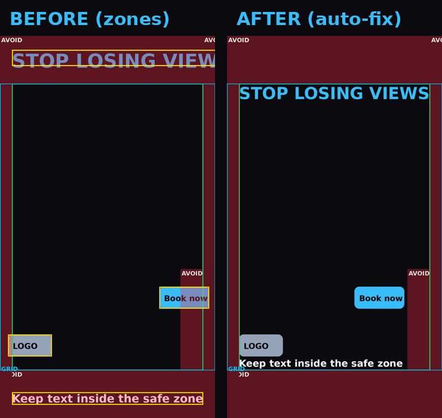

<div align="center">

# Social Safe Zone

**Never lose a headline behind a button again.**
A Claude skill + toolkit that keeps every text, logo and CTA inside the safe zone of Instagram, TikTok, YouTube Shorts and LinkedIn.

  



</div>

## What it does

| | |
|---|---|
| **Presets for 8 formats** | IG Reel, Story, Story (strict), Feed 4:5, TikTok, YouTube Shorts, LinkedIn 4:5 and 16:9 |
| **Auto-fix** | Moves or scales any element that sits in a danger area |
| **Pass / fail check** | Works on a layout, an image or a whole video, with an overlay image |
| **Fake app preview** | See your frame inside a mock Instagram / TikTok UI before you post |
| **`zones.json`** | One file holds every number. Edit it and everything follows |
| **Works anywhere** | Remotion, HTML/CSS, Python, ffmpeg, Canva, CapCut, Premiere |
| **Guide PNGs** | Ready overlays for every format in `assets/guides/` |

## Install

**Claude Code / Claude skills folder**
```bash
git clone https://github.com/<your-username>/social-safe-zone ~/.claude/skills/social-safe-zone
pip install -r ~/.claude/skills/social-safe-zone/requirements.txt
```
**Claude.ai:** zip the folder (SKILL.md at the root) and upload it under Settings > Capabilities > Skills.

Then just ask: *"Make a 15 second reel about X"*. Claude uses the zones automatically.

## Use it without Claude

```bash
python scripts/zones_lib.py list                                   # all presets
python scripts/zones_lib.py show ig-reel                           # safe rectangle
python scripts/check_zones.py my_reel.mp4 --preset ig-reel --overlay check.png
python scripts/autofix.py layout.json                              # fix a layout
python scripts/preview_mock.py frame.png --preset ig-reel --out mock.png
python scripts/make_guides.py --preset ig-reel --on frame.png --out guide.png
```
More: [`references/integrations.md`](references/integrations.md)

## Safe areas (1080 px wide)

| Preset | Size | Free margin (top / bottom / left / right) | Extra avoid area |
|---|---|---|---|
| `ig-reel` | 1080x1920 | 240 / 240 / 60 / 60 | button column, bottom right |
| `ig-story` | 1080x1920 | 155 / 155 / 60 / 60 | none |
| `ig-story-strict` | 1080x1920 | 250 / 250 / 60 / 60 | none |
| `ig-feed` | 1080x1350 | 54 / 54 / 34 / 34 | grid crop is 1012x1350 |
| `tiktok` | 1080x1920 | 130 / 480 / 60 / 120 | none |
| `yt-shorts` | 1080x1920 | 160 / 420 / 60 / 140 | none |
| `linkedin-4x5` | 1080x1350 | 60 each side | none |
| `linkedin-16x9` | 1920x1080 | 54 / 54 / 96 / 96 | none |

Instagram values for Reels, Stories and Feed come from the 2025 dimension charts. TikTok, Shorts and LinkedIn values are community estimates (marked in `zones.json`). Apps change their UI, so test one post before client work, and send a PR if you measure better numbers.

## Contribute

The easiest PR: add or correct a preset in `zones.json`, then run
```bash
python scripts/export_zones.py css > templates/safezone.css
python scripts/export_zones.py ts  > templates/zones.ts
python scripts/make_guides.py --all
```

## Roadmap
- [ ] Facebook Reels, Snapchat, Pinterest presets
- [ ] Built-in OCR-free text detector
- [ ] After Effects / Premiere guide templates

## Author

Made by **Devansh Tiwari** (Dubai) · [LinkedIn](https://linkedin.com/in/tiwari-devansh)

If this saved you a re-export, give it a star.

MIT License
